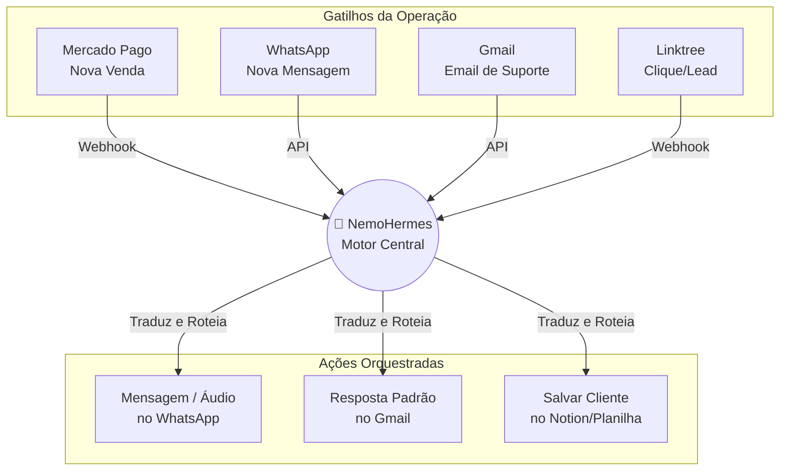

# 🔱 NemoHermes

> **O Sistema Nervoso do One-Person Business.** Um orquestrador universal projetado para mapear e unificar TODAS as suas ferramentas — Gmail, WhatsApp, Mercado Pago, Linktree — eliminando o *context switching* de operar um negócio sozinho.

[]()
[]()

## 🎯 O Problema (A Dor)

Ser um *One-Person Business* significa ser o departamento de marketing, vendas, suporte e financeiro ao mesmo tempo. Para o negócio rodar, você passa o dia com 15 abas abertas e pulando de tela em tela: 
* O **WhatsApp Web** apitando com leads novos;
* O **Gmail** lotado de dúvidas de clientes e fornecedores;
* O **Mercado Pago** (ou Stripe/Asaas) para gerar links e conferir pagamentos;
* O **Linktree** e as redes sociais para capturar quem chega.

O resultado? **Context Switching Operacional.** Você passa o dia como um "copiador e colador" humano. Pula de plataforma em plataforma, tenta amarrar dados desconexos, perde mensagens importantes na confusão e acaba exausto operando ferramentas em vez de focar na estratégia.

## 🚀 A Solução: NemoHermes

O **NemoHermes** é um orquestrador central que mapeia *toda* a sua esteira operacional. Ele atua como o maestro definitivo (ou o "cérebro") do seu negócio.

Em vez de você operar ferramentas isoladas e caóticas, o NemoHermes "ouve" tudo o que acontece (entradas) e orquestra as reações (saídas). Caiu um pagamento no Mercado Pago? Ele mapeia isso e orquestra automaticamente um onboarding no WhatsApp. Chegou um email no Gmail? Ele intercepta e você lida com tudo a partir de um motor central.

### ✨ Principais Recursos

- 🔌 **Mapeamento Universal (Tudo em Um):** Conecte Gmail, WhatsApp, Mercado Pago, Linktree e qualquer ferramenta essencial para sua operação funcionar.
- 🧠 **Orquestração Cross-Platform:** Faça ferramentas que não se conversam trabalharem juntas. O financeiro (Mercado Pago) agora fala fluentemente com o atendimento (WhatsApp).
- 🛡️ **Fim do Trabalho Braçal:** Elimine zaps manuais e integrações engessadas. O orquestrador lida com a lógica complexa, retentativas e formatação de dados.
- 📊 **Única Fonte da Verdade (Single Source of Truth):** Centralize a sua operação. Pare de abrir 5 apps para saber se o cliente pagou, recebeu o email e leu a mensagem.

## 🏗️ Como Funciona (Arquitetura de Alto Nível)



## 🛠️ Começando (Quickstart)

*(Exemplo ilustrativo de como o SDK mapeará sua operação)*

### Instalação

```bash
npm install @nemohermes/core
```

### Exemplo de Uso (Fluxo Operacional sem Context Switching)

```javascript
import { NemoHermes } from '@nemohermes/core';

const os = new NemoHermes({
  platforms: ['mercado_pago', 'whatsapp', 'gmail']
});

// O orquestrador mapeia passivamente um pagamento aprovado no Mercado Pago
os.on('mercado_pago.payment_approved', async (event) => {
  
  const { cliente, valor, produto } = event.payload;

  // Ele orquestra múltiplas saídas automaticamente, sem você precisar abrir NADA:
  await os.dispatch([
    {
      platform: 'whatsapp',
      action: 'SEND_MESSAGE',
      payload: { 
        to: cliente.telefone, 
        text: `Opa ${cliente.nome}! Vi aqui no Mercado Pago que sua compra do ${produto} aprovou. Seja bem-vindo!` 
      }
    },
    {
      platform: 'gmail',
      action: 'SEND_EMAIL',
      payload: { 
        to: 'voce@seunegocio.com', 
        subject: `💰 Ka-ching! Nova venda de R$${valor}` 
      }
    }
  ]);
});
```

## 🎯 Escopo do MVP (Minimum Viable Product)

Para a versão v0.1, o foco é construir o alicerce operacional do negócio de uma pessoa só, mapeando as três pilastras vitais: **Pagamentos, Comunicação/Vendas e Suporte**.

### Conectores Iniciais (v0.1)
*   **Financeiro (Vendas):** Mercado Pago (Mapeamento de pagamentos via Webhooks).
*   **Comunicação Direta:** WhatsApp (Envio e recebimento de mensagens para automação de atendimento/vendas).
*   **Suporte/E-mail:** Gmail (Leitura de caixa de entrada e envio de e-mails orquestrados).
*   **Links/Captura:** Linktree ou similares (Mapeamento de fluxo de entrada).

### Core Engine (v0.1)
*   **Listener Universal:** O motor que fica escutando (via API ou webhooks) todos os gatilhos das suas ferramentas simultaneamente.
*   **Dispatcher:** O motor que traduz a sua ordem no formato correto de saída (ex: converte para a API oficial do WhatsApp ou envia pro SMTP do Gmail).
*   **Gestor de Sessão:** Controle centralizado dos tokens (OAuth do Google, API Key do Mercado Pago, Sessão do WhatsApp) para você não precisar logar várias vezes.

## 🤝 Como Contribuir

1. Faça um Fork do projeto
2. Crie uma branch para sua feature (`git checkout -b feature/ConectorNotion`)
3. Faça o commit das suas alterações (`git commit -m 'Add conector para Notion'`)
4. Faça o push para a branch (`git push origin feature/ConectorNotion`)
5. Abra um Pull Request

## 📄 Licença

Este projeto está licenciado sob a licença MIT - veja o arquivo [LICENSE.md](LICENSE.md) para detalhes.
